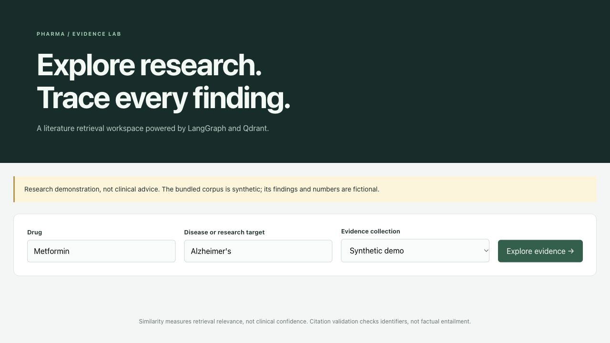
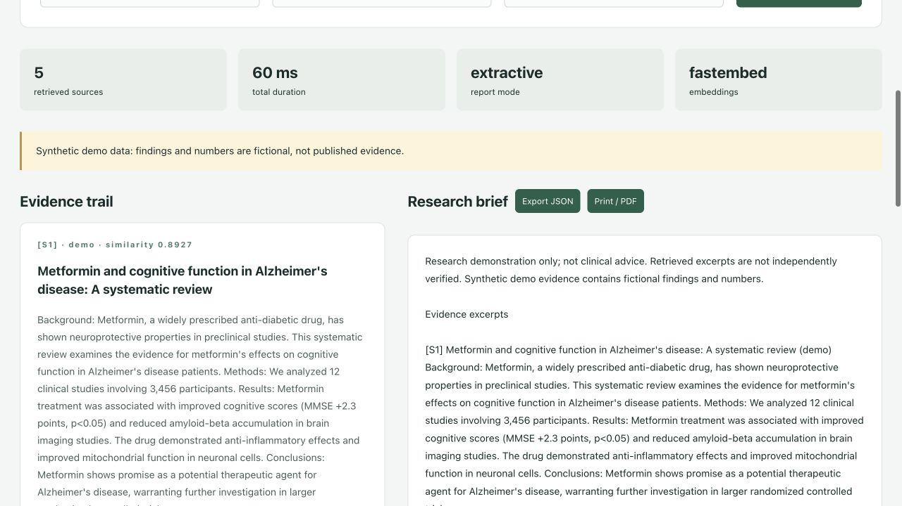
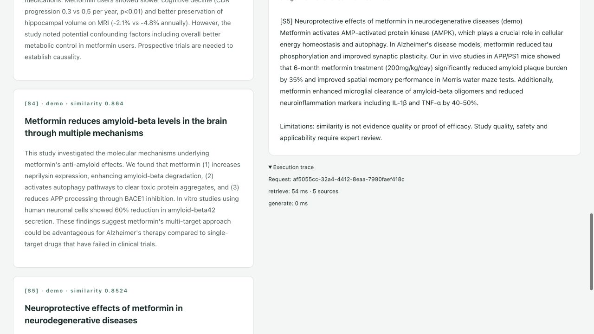
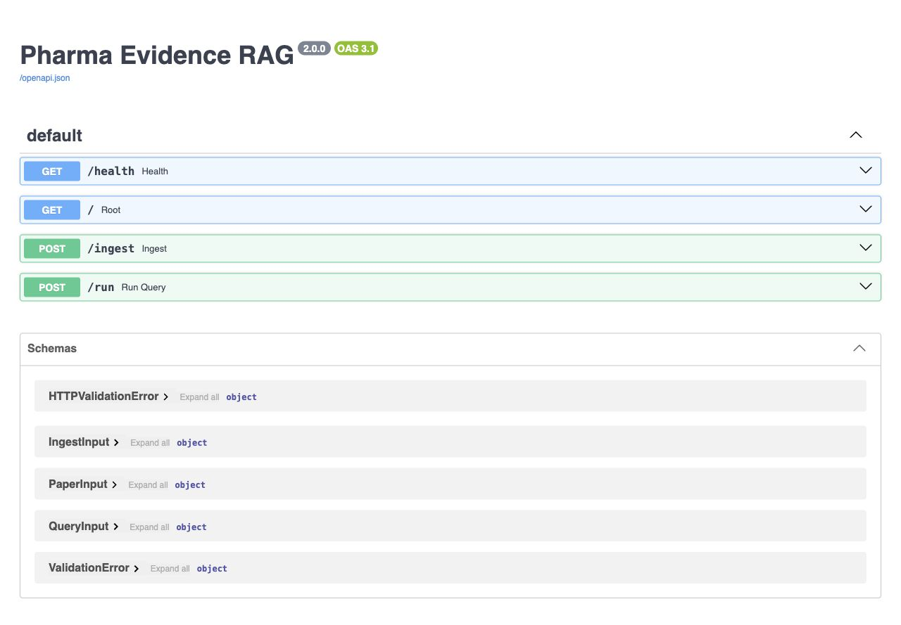
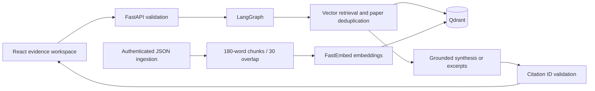
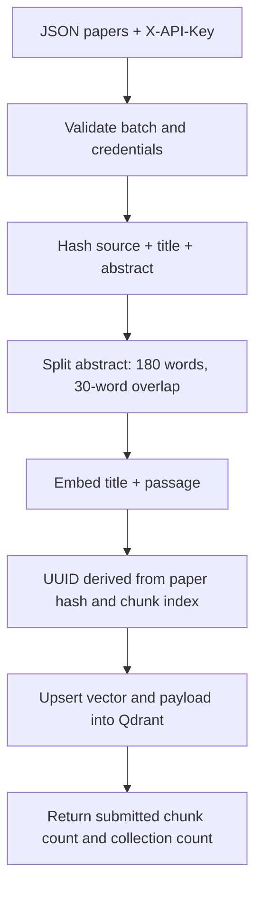
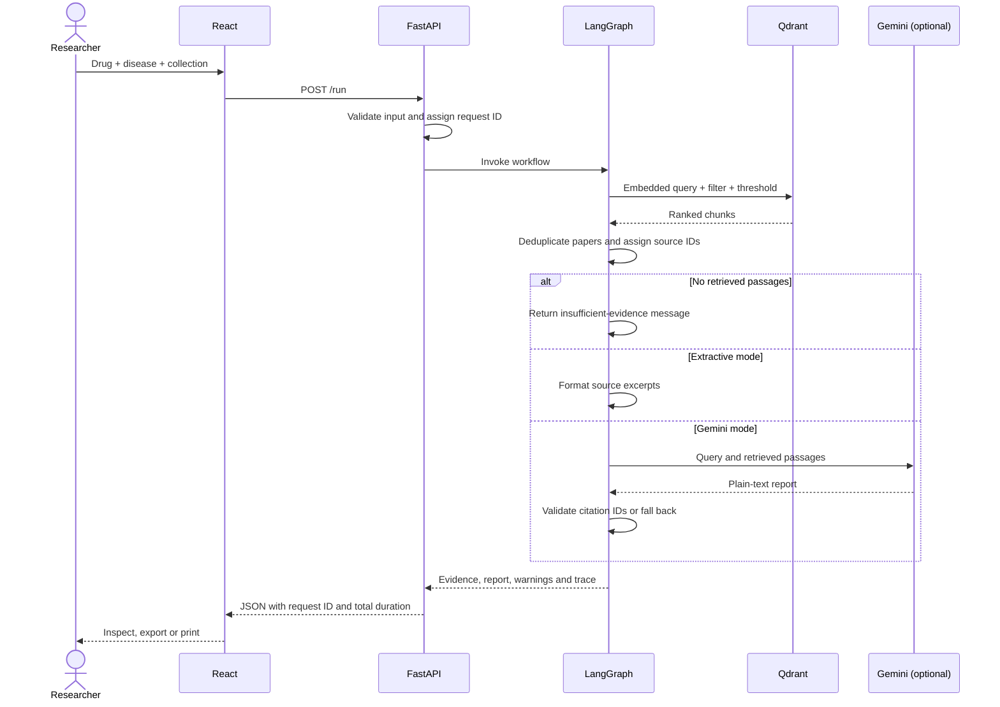

# Pharma Evidence RAG

A research literature workspace using **FastAPI, LangGraph, Qdrant, FastEmbed and React**, with optional Gemini synthesis. Built to demonstrate retrieval engineering, API design, grounded generation and reproducible evaluation.

**This is a research demonstration, not clinical decision support.** The bundled ten-paper corpus is synthetic. Its numbers and findings are fictional. Import authentic, appropriately licensed abstracts for meaningful research; uploaded text is not independently verified.


[Quick start](#run-locally) · [Screenshots](#screenshots) · [Architecture](#architecture) · [API](#api) · [Evaluation](#verification-and-evaluation) · [Roadmap](#roadmap)

## What this project demonstrates

A drug–disease query is useful only if a reviewer can inspect the evidence behind the answer. This application pairs vector retrieval with a visible source trail: every returned passage has a source label, a similarity score and a request-local citation ID. The default report reproduces retrieved excerpts; optional Gemini synthesis adds a generated research brief with citation membership checks and explicit fallback behavior.

| Engineering area | Implementation |
|---|---|
| Backend systems | Validated FastAPI endpoints, lifecycle-managed storage, protected ingestion, error correlation IDs |
| Retrieval | Overlapping chunks, local semantic embeddings, cosine search, metadata filters, paper deduplication |
| LLM integration | Evidence-only prompt, source IDs, provider timeout, invalid-citation fallback, no-evidence abstention |
| Full stack | React evidence inspection, real timings, JSON export, print/PDF layout |
| Delivery | Automated tests, GitHub Actions, Docker packaging, configurable local/cloud storage |

## Screenshots

Captured from the running application on October 13, 2026, using **FastEmbed + extractive reporting** and the **synthetic demo collection**. These are actual UI captures, not mockups. Timings are from one local request and are not a latency benchmark.

### Query workspace

Choose a drug, disease and evidence collection. The synthetic-data notice remains visible before analysis.



### Retrieved evidence and research brief

Inspect ranked passages alongside the cited report. The metrics show the actual embedding backend and report mode; source similarity is not a measure of medical confidence.



### Execution trace

Expand the trace to inspect the request identifier and completed retrieval/generation timings. A zero-millisecond stage means the measured duration rounded to zero, not that the stage was skipped.



### Interactive API documentation

FastAPI exposes endpoint schemas and interactive request forms at `/docs`. Ingestion is available through the API; the current frontend does not provide an upload form.



## Technology stack

| Layer | Technology | Responsibility |
|---|---|---|
| Interface | React 18, Vite, CSS | Query form, evidence cards, reports, export |
| HTTP API | FastAPI, Pydantic | Request validation, OpenAPI, CORS |
| Workflow | LangGraph | Explicit retrieve → report state transitions |
| Embeddings | FastEmbed, `BAAI/bge-small-en-v1.5` | Local semantic text vectors |
| Vector database | Qdrant | Persistent points, cosine search, payload filtering |
| Optional generation | Google GenAI SDK / Gemini | Synthesis from retrieved excerpts |
| Verification | pytest, FastAPI TestClient | Storage, API, fallback and citation tests |
| Packaging | Docker Compose, GitHub Actions | Local persistence and automated checks |

## Run locally

Requires Python 3.11+ and Node 22.12+. No database account or paid API key is required.

```bash
git clone https://github.com/abhikhurannah/pharma-agentic-langgraph.git
cd pharma-agentic-langgraph
python3.11 -m venv .venv
source .venv/bin/activate
pip install -r requirements.txt
cp .env.example .env
uvicorn backend.main:app --reload
```

In another terminal:

```bash
cd frontend
npm ci
npm run dev
```

Open http://localhost:3000 and API docs at http://localhost:8000/docs. First startup downloads `BAAI/bge-small-en-v1.5` for real semantic embeddings. For a fully offline smoke demo, set `EMBEDDING_BACKEND=hash` before startup: this is a token hashing baseline, **not semantic embedding**. Reports use extractive mode by default; enable Gemini below for abstractive RAG.

## Architecture



- Persistent local vector database, or remote Qdrant via environment configuration.
- Deterministic content IDs make repeated ingestion idempotent. Changed documents are new versions; old versions are retained.
- Embedding model and chunk schema namespaced collections prevent mixing incompatible vectors.
- Cosine similarity threshold, source filters, and one highest-ranking passage per paper; up to `top_k * 8` candidates are considered, so highly repetitive documents can reduce returned paper count.
- Citation IDs and source passages returned with every report. Invalid/missing citation IDs or provider failures trigger an explicit extractive fallback.
- Empty retrieval abstains rather than calling the model. Similarity is not clinical confidence; citation ID validation does not prove claim support.
- Real completed-stage timings, request IDs, JSON export, browser print/PDF, and React text rendering (no generated HTML execution).
- Authenticated ingestion; environment-based secrets; health checks; automated API/storage tests; CI and Docker.

### Ingestion and vector identity



Each payload stores `paper_id`, `title`, the passage in `abstract`, `link`, `source`, and `chunk_index`. Identical text in the same source namespace maps to the same point IDs. A metadata-only URL update overwrites those points; changing title or abstract creates a different paper identity and retains earlier content. The reported `chunks_upserted` counts submitted points, not exclusively new points.

The collection name incorporates embedding backend, model name and chunking schema. Switching these settings selects a separate collection; previously uploaded literature must be re-ingested into it. Qdrant persistence avoids duplicate records, but the small demo corpus is still re-embedded on each startup.

### Query lifecycle



The graph is a fixed two-stage workflow, not an autonomous planner. After embedding the query, retrieval asks for up to `top_k × 8` candidate chunks above `MIN_SCORE`, applies the source filter, and keeps the highest-scoring chunk per paper until `top_k` papers are selected. Citation IDs such as `[S1]` are local to a response; use `paper_id` when comparing sources across requests.

### Report modes and failure behavior

| Response mode | Trigger | Output |
|---|---|---|
| `extractive` | Default configuration | Cited source excerpts and limitations |
| `gemini` | Gemini enabled and output passes ID checks | Plain-text synthesized brief |
| `extractive_fallback` | Missing key, provider error, empty output or invalid/missing source IDs | Excerpts plus a warning |
| `abstained` | No passages pass retrieval | Insufficient-evidence message; no LLM call |

The Gemini request uses a 45-second provider timeout and a bounded output-token setting. The browser aborts its request after 90 seconds; this does not guarantee cancellation of server-side work. Stage durations are measured after completion rather than streamed live. Model text is rendered as text, not executable HTML.

## Configuration reference

Copy `.env.example` to `.env` once. Backend settings are loaded from the repository root, and environment variables override file values. Restart the backend after configuration changes.

| Variable | Default | Purpose |
|---|---|---|
| `EMBEDDING_BACKEND` | `fastembed` | Semantic encoder; `hash` is the offline token baseline |
| `EMBEDDING_MODEL` | `BAAI/bge-small-en-v1.5` | FastEmbed model identifier |
| `QDRANT_PATH` | `data/qdrant` | Persistent embedded storage directory |
| `QDRANT_URL` | empty | Remote Qdrant endpoint; overrides local storage |
| `QDRANT_API_KEY` | empty | Optional remote database credential |
| `GENERATION_MODE` | `extractive` | Set `gemini` to enable synthesis |
| `GEMINI_API_KEY` | empty | Required only for Gemini synthesis |
| `GEMINI_MODEL` | `gemini-2.5-flash` | Configurable generation model |
| `ADMIN_API_KEY` | empty | Enables and protects `/ingest` |
| `MIN_SCORE` | `0.35` | Configured cosine cutoff, accepted range 0–1 |
| `CORS_ORIGINS` | `["http://localhost:3000"]` | Allowed frontend origins as a JSON list |
| `VITE_API_URL` | `http://localhost:8000` | Frontend API base; set in frontend environment at build time |

Thresholds should be calibrated on your corpus. Dense similarity may return related passages that do not answer the requested drug–disease question; passing the threshold alone does not establish direct evidence.

## Optional keys (keep them in `.env`, never chat or Git)

### Gemini synthesis

1. Open [Google AI Studio API keys](https://aistudio.google.com/apikey), sign in, and create a key in your selected Google project.
2. Set `GEMINI_API_KEY` in `.env` and `GENERATION_MODE=gemini`.
3. Restart the backend. Change `GEMINI_MODEL` if your account does not support the configured model.

Retrieved passages and the query are sent to Google when Gemini mode is enabled. Provider errors fall back to excerpts and appear as a warning in the response. The previous repository included an embedded key: revoke it in AI Studio; deleting source text does not remove Git history.

### Qdrant Cloud (optional)

1. Create a cluster in [Qdrant Cloud](https://cloud.qdrant.io/).
2. Copy its endpoint to `QDRANT_URL` and create/copy a database API key into `QDRANT_API_KEY`.
3. Restart. Local storage is ignored when a URL is configured. Cloud is useful for multiple API workers; embedded mode requires **one process/worker per storage directory**.

References: [Qdrant FastEmbed integration](https://qdrant.tech/documentation/fastembed/fastembed-semantic-search/), [Gemini generation API](https://ai.google.dev/api/generate-content).

## Import your literature

Generate an ingestion credential and put it in `.env` as `ADMIN_API_KEY`:

```bash
python -c "import secrets; print(secrets.token_urlsafe(32))"
```

Restart the backend, then call `POST /ingest` through Swagger with the `X-API-Key` header. Request shape:

```json
{"papers":[{"title":"Your actual paper title","abstract":"Paste an appropriately licensed abstract with at least 30 characters.","link":"https://example.org/paper"}]}
```

Only HTTP(S) source URLs are accepted. Up to 100 abstracts of 30,000 characters each are accepted per batch. Select **Uploaded literature** in the UI to exclude fictional sources. Re-importing identical text does not duplicate chunks. There is no PDF parser or PubMed live integration in this release.

## API

| Endpoint | Purpose |
|---|---|
| `GET /health` | Readiness, indexed chunk count and configured modes |
| `POST /ingest` | Validated paper ingestion; requires `X-API-Key` |
| `POST /run` | Drug, disease, `top_k` (1–10), source (`all`, `demo`, `uploaded`) |

```bash
curl http://localhost:8000/run -H 'Content-Type: application/json' \
  -d '{"drug":"Metformin","disease":"Alzheimer","top_k":5,"source":"demo"}'
```

### Request and response contract

`POST /run` accepts trimmed `drug` (2–120 characters), `disease` (2–160 characters), `top_k` (1–10, default 5), and `source` (`all`, `demo`, `uploaded`; API default `all`). The UI starts with `demo`. Unknown request fields are rejected.

| Response field | Meaning |
|---|---|
| `papers` | Ranked passage payloads with `score` and `citation_id` |
| `final_report` | Plain-text excerpts, synthesis or abstention message |
| `generation_mode` | Actual mode used, including fallback |
| `embedding_backend` | Configured embedding implementation |
| `warnings` | Synthetic-source notice and/or generation fallback |
| `trace` | Completed stage names and durations; retrieval includes source count |
| `request_id`, `duration_ms` | Correlation ID and measured total execution time |
| `summaries` | Empty compatibility field in the current workflow |

`PaperInput` requires a 5–500 character title and a 30–30,000 character abstract. Its URL is optional; when supplied it must use HTTP(S). A batch contains 1–100 papers.

| Status | Typical meaning |
|---|---|
| `200` | Successful analysis or ingestion; inspect mode/warnings for fallback |
| `401` | Missing or incorrect ingestion credential when ingestion is enabled |
| `422` | Request validation failed |
| `503` | Ingestion disabled, or analysis unavailable; analysis errors include a request ID |

## Verification and evaluation

```bash
python -m pytest -q
EMBEDDING_BACKEND=hash python -m scripts.evaluate
# Real embedding evaluation (downloads model on first use):
EMBEDDING_BACKEND=fastembed python -m scripts.evaluate
cd frontend && npm ci && npm run build
```

The benchmark reports hit rate@5 and MRR@5 on **three synthetic smoke queries**. These are regression checks, not evidence of general biomedical accuracy. For a serious ML evaluation, curate held-out authentic query/relevance judgments, compare lexical and semantic baselines, and measure retrieval recall and claim entailment separately.

### Recorded verification

The implementation was checked locally on October 13, 2026:

| Check | Observed result |
|---|---|
| pytest | 9 passing cases |
| Frontend production build | Passed |
| Browser → API → report | Passed with local retrieval and extractive mode |
| FastEmbed smoke retrieval | Hit rate@5 **1.00**, MRR@5 **1.00** |
| Hash baseline smoke retrieval | Hit rate@5 **0.67**, MRR@5 **0.67** |
| Live Gemini / Docker runtime | Not exercised during this verification |

Both retrieval runs use the same **three synthetic queries** and ten-paper fixture. Hit rate@5 counts queries whose expected paper appears among the first five results; MRR@5 averages the reciprocal rank, assigning zero to misses. This tiny test set is a plumbing/regression check, not a held-out scientific evaluation. The script prints metrics and does not currently enforce a CI quality threshold.

Tests cover persistent storage across reopen, idempotent ingestion, ranking/filtering, overlapping chunk boundaries, empty evidence, API validation, ingestion authorization, missing-key fallback, valid/invalid provider citation IDs, and removal of fictional source links. Provider outputs are mocked in citation tests; no paid API calls are required.

## Container deployment

```bash
cp .env.example .env  # only if you have not configured it already
docker compose up --build
```

Docker exposes the API on port 8000 and persists local vectors/model cache. Run the frontend separately or host its `dist` build with `VITE_API_URL` set at build time. Set `CORS_ORIGINS` to your frontend origin. The previous Vercel all-in-one deployment is superseded: embedded vectors require persistent storage and startup may download a model. Use a persistent container backend.

Before public deployment add gateway authentication/rate limits for `/run`, request-size limits, HTTPS and provider budgets. The current API is intended for local demos; ingestion auth alone does not make public generation safe from abuse. No multi-tenant isolation, background ingestion queue, or independent factual verifier is claimed.

## Resume / interview talking points

- Built a full-stack literature RAG system with LangGraph orchestration, persistent Qdrant indexing and local semantic embeddings.
- Implemented idempotent chunk ingestion, source-filtered retrieval, citation validation, abstention and graceful provider fallback.
- Added API/storage integration tests, synthetic retrieval evaluation, CI, Docker packaging and an evidence inspection UI.

Use measured results from your own real corpus; do not claim clinical accuracy or production scale based on the demo dataset.

## Repository map

```text
pharma-agentic-langgraph/
├── backend/
│   ├── config.py           # Environment configuration
│   ├── models.py           # Request contracts and graph state
│   ├── retrieval.py        # Chunking, embedding and Qdrant operations
│   ├── tools.py            # Optional synthesis and extractive fallback
│   ├── graph.py            # Retrieve → report workflow
│   └── main.py             # API routes and storage lifecycle
├── frontend/src/           # React evidence workspace and styling
├── data/mock_papers.json   # Fictional demonstration corpus
├── docs/screenshots/       # Real application captures used above
├── scripts/evaluate.py     # Three-query retrieval smoke evaluation
├── tests/test_rag.py        # Storage, API and generation tests
├── .github/workflows/ci.yml
├── .env.example
├── Dockerfile
└── compose.yaml
```

## Design decisions and limitations

| Choice | Benefit | Tradeoff |
|---|---|---|
| Local semantic embeddings | No embedding API key; corpus text stays local during embedding | Initial model download and local compute |
| Embedded Qdrant | Simple persistent development setup | One process per storage directory |
| Content-derived IDs | Repeatable, idempotent ingestion | Revised text retains old versions until explicitly managed |
| One passage per paper | More paper diversity in a bounded context | Can omit relevant detail from other chunks |
| Extractive default | Deterministic reports without provider costs | No cross-paper generative synthesis |
| Citation membership checks | Detects missing/unknown source IDs | Does not verify every claim or factual entailment |
| Fixed LangGraph workflow | Clear state transitions and inspectable timing | No dynamic tool planning or autonomous research |

No biomedical accuracy, production scalability or clinical suitability is claimed. The current collection is small and synthetic. There is no PubMed synchronization, PDF parsing, cross-encoder reranking, background queue, document deletion UI, user account system, per-user corpus isolation or server-side report history. Remote Qdrant configuration is available but was not exercised in the local verification.

## Troubleshooting

| Symptom | Check or action |
|---|---|
| Startup takes time on first run | FastEmbed may be downloading its model; inspect backend logs and network availability |
| Qdrant storage lock error | Stop the other API process using the same directory; embedded mode uses one worker |
| Frontend reports a fetch failure | Confirm `/health`, frontend API URL, API port and exact CORS origin |
| Uploaded collection is empty | Ingest literature through `/docs`; changing the embedding model selects another collection |
| Ingestion returns 503 | Set `ADMIN_API_KEY` and restart the backend |
| Gemini returns excerpts | Inspect response warnings; verify mode, key and model availability |
| A related but irrelevant source appears | Inspect passages and calibrate `MIN_SCORE`; similarity is not question-answer relevance validation |
| `python3.11` is unavailable | Use an installed Python 3.11+ executable to create the virtual environment |
| Port 3000 or 8000 is in use | Stop the previous development server, or update port/API URL/CORS settings consistently |

## Demo walkthrough

1. Start the API and frontend, then confirm `/health` reports `ready`.
2. Run **Metformin → Alzheimer's** against **Synthetic demo**.
3. Inspect source labels and similarity scores next to the research brief.
4. Expand **Execution trace** and export the complete response as JSON.
5. Import an authentic abstract through `/docs`, then select **Uploaded literature**.
6. Optionally enable Gemini and explain the difference between excerpts, synthesis, citation validation and fallback.

## Roadmap

- [ ] Authentic, licensed literature corpus and held-out relevance judgments
- [ ] PubMed ingestion with provenance and update tracking
- [ ] Hybrid lexical/dense retrieval and cross-encoder reranking
- [ ] Claim-level support verification and evaluation
- [ ] Document version management and deletion
- [ ] Background ingestion jobs, streaming progress and caching
- [ ] Authentication, per-user collections, rate limits and deployment monitoring

These items are planned extensions, not current functionality.

## Contributing

Create a focused branch, add meaningful tests for behavioral changes, run `python -m pytest -q` and the frontend build, and explain validation in the pull request. For retrieval changes, run both baseline and semantic evaluations and describe the corpus used. Keep credentials, local vector storage and model caches out of Git. Changes to documentation screenshots should preserve visible mode labels and synthetic-data notices.
