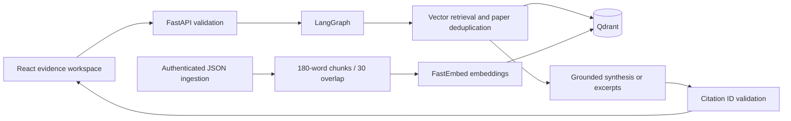

# Pharma Evidence RAG

A research literature workspace using **FastAPI, LangGraph, Qdrant, FastEmbed and React**, with optional Gemini synthesis. Built to demonstrate retrieval engineering, API design, grounded generation and reproducible evaluation.

**This is a research demonstration, not clinical decision support.** The bundled ten-paper corpus is synthetic. Its numbers and findings are fictional. Import authentic, appropriately licensed abstracts for meaningful research; uploaded text is not independently verified.

## Run locally

Requires Python 3.11+ and Node 22.12+. No database account or paid API key is required.

```bash
python3.11 -m venv .venv
source .venv/bin/activate
pip install -r requirements.txt
cp .env.example .env
uvicorn backend.main:app --reload
```

In another terminal:

```bash
cd frontend
npm ci
npm run dev
```

Open http://localhost:3000 and API docs at http://localhost:8000/docs. First startup downloads `BAAI/bge-small-en-v1.5` for real semantic embeddings. For a fully offline smoke demo, set `EMBEDDING_BACKEND=hash` before startup: this is a token hashing baseline, **not semantic embedding**. Reports use extractive mode by default; enable Gemini below for abstractive RAG.

## Architecture



- Persistent local vector database, or remote Qdrant via environment configuration.
- Deterministic content IDs make repeated ingestion idempotent. Changed documents are new versions; old versions are retained.
- Embedding model and chunk schema namespaced collections prevent mixing incompatible vectors.
- Cosine similarity threshold, source filters, and one highest-ranking passage per paper; up to `top_k * 8` candidates are considered, so highly repetitive documents can reduce returned paper count.
- Citation IDs and source passages returned with every report. Invalid/missing citation IDs or provider failures trigger an explicit extractive fallback.
- Empty retrieval abstains rather than calling the model. Similarity is not clinical confidence; citation ID validation does not prove claim support.
- Real completed-stage timings, request IDs, JSON export, browser print/PDF, and React text rendering (no generated HTML execution).
- Authenticated ingestion; environment-based secrets; health checks; automated API/storage tests; CI and Docker.

## Optional keys (keep them in `.env`, never chat or Git)

### Gemini synthesis

1. Open [Google AI Studio API keys](https://aistudio.google.com/apikey), sign in, and create a key in your selected Google project.
2. Set `GEMINI_API_KEY` in `.env` and `GENERATION_MODE=gemini`.
3. Restart the backend. Change `GEMINI_MODEL` if your account does not support the configured model.

Retrieved passages and the query are sent to Google when Gemini mode is enabled. Provider errors fall back to excerpts and appear as a warning in the response. The previous repository included an embedded key: revoke it in AI Studio; deleting source text does not remove Git history.

### Qdrant Cloud (optional)

1. Create a cluster in [Qdrant Cloud](https://cloud.qdrant.io/).
2. Copy its endpoint to `QDRANT_URL` and create/copy a database API key into `QDRANT_API_KEY`.
3. Restart. Local storage is ignored when a URL is configured. Cloud is useful for multiple API workers; embedded mode requires **one process/worker per storage directory**.

References: [Qdrant FastEmbed integration](https://qdrant.tech/documentation/fastembed/fastembed-semantic-search/), [Gemini generation API](https://ai.google.dev/api/generate-content).

## Import your literature

Generate an ingestion credential and put it in `.env` as `ADMIN_API_KEY`:

```bash
python -c "import secrets; print(secrets.token_urlsafe(32))"
```

Restart the backend, then call `POST /ingest` through Swagger with the `X-API-Key` header. Request shape:

```json
{"papers":[{"title":"Your actual paper title","abstract":"Paste an appropriately licensed abstract with at least 30 characters.","link":"https://example.org/paper"}]}
```

Only HTTP(S) source URLs are accepted. Up to 100 abstracts of 30,000 characters each are accepted per batch. Select **Uploaded literature** in the UI to exclude fictional sources. Re-importing identical text does not duplicate chunks. There is no PDF parser or PubMed live integration in this release.

## API

| Endpoint | Purpose |
|---|---|
| `GET /health` | Readiness, indexed chunk count and configured modes |
| `POST /ingest` | Validated paper ingestion; requires `X-API-Key` |
| `POST /run` | Drug, disease, `top_k` (1–10), source (`all`, `demo`, `uploaded`) |

```bash
curl http://localhost:8000/run -H 'Content-Type: application/json' \
  -d '{"drug":"Metformin","disease":"Alzheimer","top_k":5,"source":"demo"}'
```

## Verification and evaluation

```bash
python -m pytest -q
EMBEDDING_BACKEND=hash python -m scripts.evaluate
# Real embedding evaluation (downloads model on first use):
EMBEDDING_BACKEND=fastembed python -m scripts.evaluate
cd frontend && npm ci && npm run build
```

The benchmark reports hit rate@5 and MRR@5 on **three synthetic smoke queries**. These are regression checks, not evidence of general biomedical accuracy. For a serious ML evaluation, curate held-out authentic query/relevance judgments, compare lexical and semantic baselines, and measure retrieval recall and claim entailment separately.

## Container deployment

```bash
cp .env.example .env  # only if you have not configured it already
docker compose up --build
```

Docker exposes the API on port 8000 and persists local vectors/model cache. Run the frontend separately or host its `dist` build with `VITE_API_URL` set at build time. Set `CORS_ORIGINS` to your frontend origin. The previous Vercel all-in-one deployment is superseded: embedded vectors require persistent storage and startup may download a model. Use a persistent container backend.

Before public deployment add gateway authentication/rate limits for `/run`, request-size limits, HTTPS and provider budgets. The current API is intended for local demos; ingestion auth alone does not make public generation safe from abuse. No multi-tenant isolation, background ingestion queue, or independent factual verifier is claimed.

## Resume / interview talking points

- Built a full-stack literature RAG system with LangGraph orchestration, persistent Qdrant indexing and local semantic embeddings.
- Implemented idempotent chunk ingestion, source-filtered retrieval, citation validation, abstention and graceful provider fallback.
- Added API/storage integration tests, synthetic retrieval evaluation, CI, Docker packaging and an evidence inspection UI.

Use measured results from your own real corpus; do not claim clinical accuracy or production scale based on the demo dataset.
